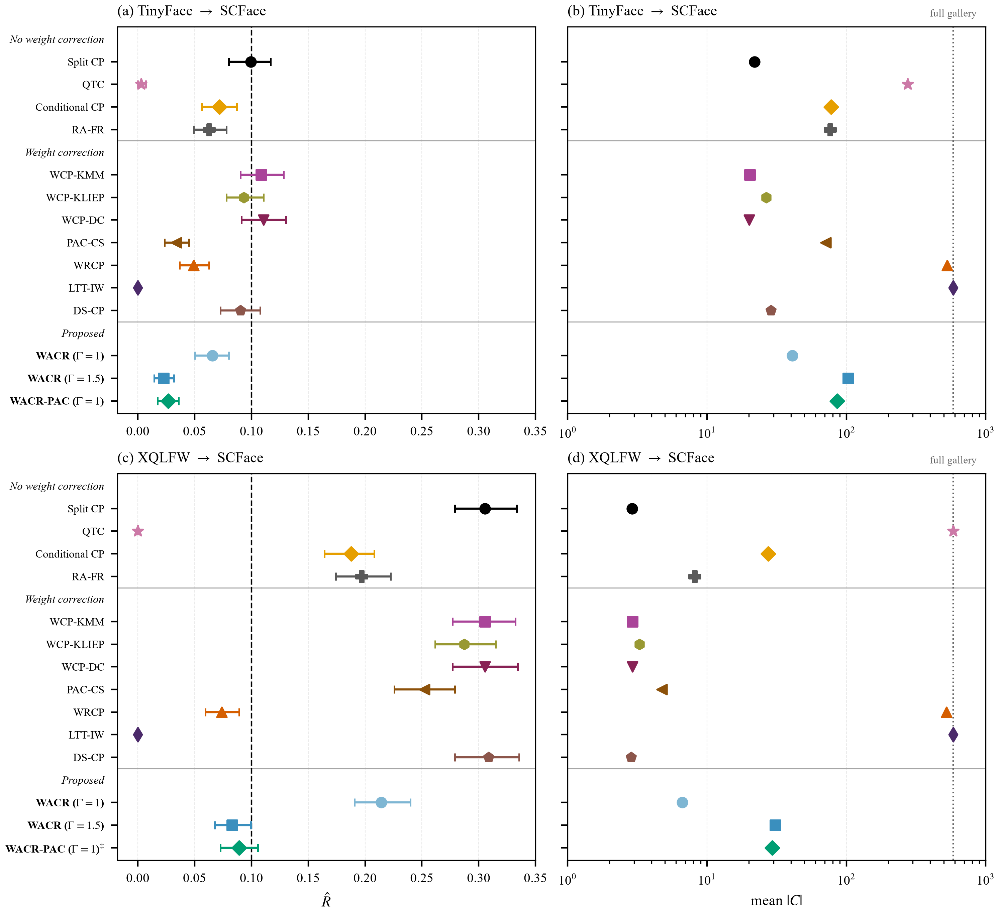
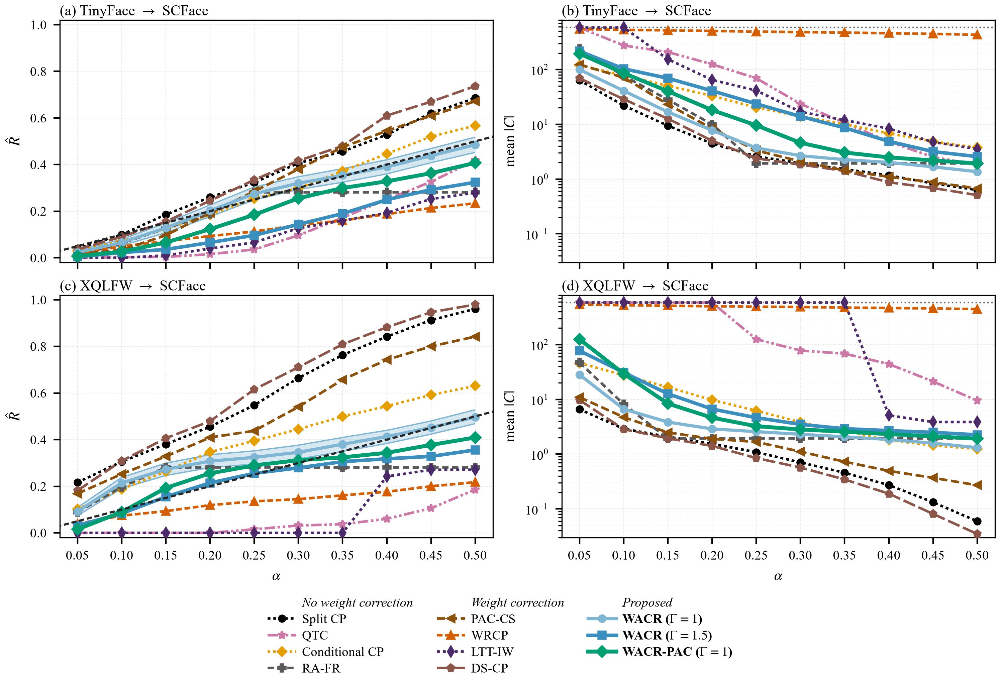

# WACR: Weighted Adaptive Conformal Retrieval

WACR constructs prediction sets for closed-set retrieval under covariate shift. Calibration uses importance weights on a one-dimensional top-1 similarity statistic, an uncertainty adapter for per-query set sizes, and either a weighted conformal threshold or a PAC Bernstein bound. This repository reproduces the paper tables and figures from cached embeddings (fast), from a score-level cache, or from images (requires the public datasets and a GPU).

## Install

```
python -m venv .venv
.venv\Scripts\activate          # Windows
# source .venv/bin/activate       # Linux
pip install -r requirements.txt
```

Or `conda env create -f environment.yml`.

Place embedding caches under `cache/tinyface_scface/` and `cache/xqlfw_scface/` (see `data/README.md`). Weights are not committed; AdaFace and DINOv2 checkpoints are downloaded by `scripts/download_models.py`.

## Data

See `data/README.md` for download links, licences, the expected folder layout, and how the embedding caches were built. TinyFace manifests list original QMUL relative paths (`TinyFace/Gallery/...`, `TinyFace/Queries/...`) taken from the cached embedding archives. XQLFW and SCFace manifests list file names, identity IDs, and SHA-256 of the local image files.

## Run

From cached embeddings (default, no images):

```
python run_all.py
python tests/test_reproduce.py
```

From the score-level cache (`cache_share/`, gitignored; no images and no embeddings):

```
python experiments/export_score_cache.py   # once, while embedding caches are present
python run_all.py --from-scores
python tests/test_reproduce.py --from-scores
```

`cache_share/` stores calibration and SCFace query `t` values, Method B scores against the matched and SCFace galleries, and the baseline weights (KMM, KLIEP, DC, PAC-CS, WRCP, LTT-IW, DS-CP). It is not committed.

From images (datasets + GPU):

```
python scripts/download_models.py
python run_all.py --from-images
```

Default configuration is `configs/default.yaml`: alpha grid `{0.05,...,0.50}`, `k=65`, `M=20`, `B=30`, `beta=0.5`, `delta=0.1`, seed `0`.

Query embeddings are the mean of 40 MC-dropout forwards; gallery embeddings are a single `eval()` pass. `wacr/_extract_mcd.py --seed` (default 0) seeds torch, numpy, and random. The paper's embedding cache predates that seed and is not regenerated.

## Paper items

Main coverage figure (Method B) and Method A panel, redrawn by `experiments/03_main_results.py` from the recomputed T1 / α-sweep tables:





| Paper item | Script | Output | Runtime (cache) |
|---|---|---|---|
| Table 1 datasets / Recall@K | `experiments/02_build_galleries_scores.py` | `outputs/table1_datasets.csv` | ~2 min |
| Table 2 notation | (static; no code) | — | — |
| T1 main marginal | `experiments/03_main_results.py` | `outputs/t1_marginal.csv` | ~10 min |
| Fig 3 (`B.png`) | `experiments/03_main_results.py` | `results/figures/B.png` | redrawn |
| `A_main.png` | `experiments/03_main_results.py` | `results/figures/A_main.png` | redrawn |
| A_main α-sweep | `experiments/03_main_results.py` | `outputs/a_main_alpha_sweep.csv` | with T1 |
| Table 3 robustness | `experiments/04_robustness.py` | `outputs/table3_robustness.csv` | ~15 min |
| Fig 4 sensitivity to Gamma | `experiments/04_robustness.py` | `results/figures/fig_sensitivity.png` | redrawn |
| Table 5 rank budgets | `experiments/05_pac.py` | `outputs/table5_rank_budget.csv` | ~3 min |
| Fig 6 per-query set size | `experiments/06_adaptivity.py` | `results/figures/fig_adaptivity.png` | redrawn |
| Fig 7 / Table 6 weight quality | `experiments/07_weight_quality.py` | `results/figures/fig_weight_quality.png` | redrawn |
| Table 7 / Fig 8 conditional invariance | `experiments/08_conditional_shift.py` | `results/figures/fig_conditional.png` | redrawn |
| Table 8 ablation | `experiments/09_ablation.py` | `outputs/table8_ablation.csv` | ~5 min |
| Table 9 one-at-a-time sensitivity | `experiments/10_sensitivity.py` | `outputs/table9_sensitivity.csv` | ~8 min |

`tests/test_reproduce.py` regenerates each of those CSVs (Table 2 has none) and checks them against `results/expected/` at absolute tolerance `1e-6`. `a_main_alpha_sweep.csv` holds every A_main method at α = 0.05,…,0.50 on both pairs (`R̂` and `|C|`).

Method names match the paper: Split CP, QTC, Conditional CP, RA-FR, WCP-KMM, WCP-KLIEP, WCP-DC, PAC-CS, WRCP, LTT-IW, DS-CP, WACR, WACR-PAC.

## Licence

MIT. Dataset licences are those of TinyFace, XQLFW, and SCFace (see `data/README.md`). AdaFace and DINOv2 checkpoints follow their upstream licences.
